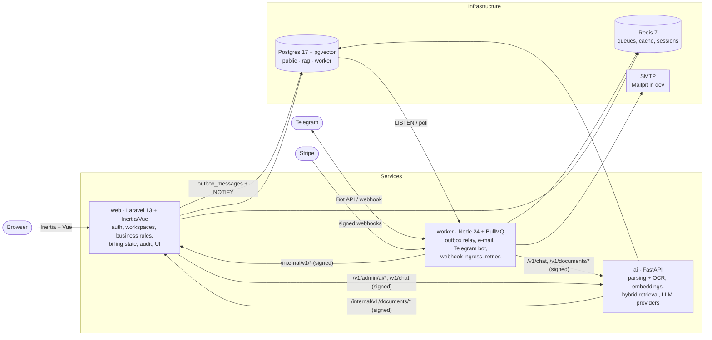

# OpsBot

**Your company rules in every employee's Telegram.** OpsBot is an operations assistant for service
companies whose staff work away from a desk (cleaning, facility and field-service teams). The company
connects its own Telegram bot, uploads its regulations (PDF, DOCX, scans with OCR), approves them and
invites employees with a QR code. Employees ask "what do I do if…" questions; the bot answers only from
approved, effective documents, cites the source, refuses honestly when unsure and passes the question to a
manager. From the same chat an employee can report an incident that is routed to the responsible manager.
Managers work in a bilingual web admin (Russian and English, light and dark themes).

Product scope and roadmap: [`docs/PLAN.md`](docs/PLAN.md). Shared platform rules: [`PLATFORM.md`](PLATFORM.md).
Domain model and service contracts: [`docs/DOMAIN_CONTRACT.md`](docs/DOMAIN_CONTRACT.md), architecture: [`docs/ARCHITECTURE.md`](docs/ARCHITECTURE.md).

> Русская версия — ниже, в разделе [«Русский»](#русский).

---

## Contents

- [Architecture](#architecture)
- [Prerequisites](#prerequisites)
- [Quick start](#quick-start)
- [Ports](#ports)
- [Everyday commands](#everyday-commands)
- [Environment variables](#environment-variables)
- [Testing](#testing)
- [Production images](#production-images)
- [Troubleshooting on Windows](#troubleshooting-on-windows)
- [Project structure](#project-structure)

## Architecture

Three services share one Postgres database (each migrates only its own schema) and talk to each other
over HMAC-signed HTTP (`X-Signature: t=…,v1=…`) with one key per service pair (`INTERNAL_KEY_WEB_WORKER`,
`INTERNAL_KEY_WEB_AI`, `INTERNAL_KEY_WORKER_AI`); every internal route also checks which service may call it. The web app never sends
e-mail or Telegram messages and never calls an LLM itself: it writes to a transactional **outbox** that the
worker relays to BullMQ queues.



Key flows: e-mail and Telegram notifications (web → outbox → worker → SMTP / Bot API → delivery callback),
knowledge ingestion (upload → outbox → worker → ai ingest → status callback), the assistant (web or Telegram →
ai `/v1/chat` → answer with citations or a refusal), fake billing (checkout → signed Stripe-shaped event →
worker webhook → web subscription). Everything runs **offline** with fake/mock drivers: no Stripe, Telegram
or LLM keys are needed.

## Prerequisites

| Tool | Version | Notes |
|---|---|---|
| Docker Desktop | 25+ (compose v2) | Postgres + pgvector, Redis 7, Mailpit |
| PHP | 8.4 | extensions: `pdo_pgsql`, `pgsql`, `mbstring`, `openssl`, `curl`, `zip`, `gd`, `fileinfo`; `redis` and `intl` recommended |
| Composer | 2.x | |
| Node.js | 24 LTS (npm 11) | |
| uv | 0.11+ | installs and pins Python **3.12** (`uv python install 3.12`) — the system Python is never used |
| Tesseract | 5.x with `rus` + `eng` | OCR of scanned PDFs/images in the ai service |

`npm run doctor` checks all of the above, the ports and the env files, and prints a fix for every problem.

## Quick start

```bash
npm run setup     # docker infra (wait for healthy) → env files + shared secrets → composer/npm/uv installs
                  # → migrations + demo seed (web, ai, worker) → web assets + worker build → Playwright
npm run dev       # web :8200 + vite :5174 + worker :8201 + ai :8202 (one terminal, prefixed logs)
```

Open <http://localhost:8200> and sign in with the seeded demo workspace owner **`demo@opsbot.test` / `password`**
(platform admin for the AI settings: **`admin@opsbot.test` / `password`**). Mail lands in Mailpit at
<http://localhost:8231>.

`npm run setup` runs `scripts/setup.ps1` on Windows and `scripts/setup.sh` elsewhere (Git Bash works too:
`bash scripts/setup.sh`). It is idempotent — re-run it after pulling: `npm ci` only runs for packages whose
`package.json`/lockfile changed since the last install (so it never pulls `node_modules` from under a running
dev server), migrations only apply what is new, secrets are never rotated. Options: `-- --fresh` (drop all
data and re-seed), `-- --reinstall` (force `npm ci` everywhere), `-- --skip-docker`, `-- --skip-build`,
`-- --skip-e2e`. Stop everything with `npm run stop` (`-- --keep-infra` leaves docker running).

## Ports

All three products of the platform can run side by side (PLATFORM.md §2).

| Service | Port | URL |
|---|---|---|
| web (Laravel) | 8200 | <http://localhost:8200> (health: `/up`) |
| web, service-to-service listener | 8203 | `WEB_URL` of the worker and ai in `npm run dev` and e2e, so a web request that waits on the worker (bot connect) or ai (assistant) is never blocked by the single-process PHP dev server |
| vite dev server | 5174 | used by `npm run dev` only |
| worker (Fastify) | 8201 | `/healthz`, `/metrics`, Bull Board `/admin/queues` |
| ai (FastAPI) | 8202 | `/healthz`, `/metrics` |
| Postgres (pgvector) | 5442 | db `opsbot` (+ `opsbot_test`, `opsbot_e2e`), user/password `app` / `app` |
| Redis 7 | 6392 | |
| Mailpit SMTP / UI | 1032 / 8231 | <http://localhost:8231> |

The machine's native Postgres (5432) and Redis 3 (6379) are **never** used; `npm run doctor` flags any env
file that points at them.

## Everyday commands

| Command | What it does |
|---|---|
| `npm run setup` | full, idempotent developer setup (see above) |
| `npm run dev` | all dev servers via `concurrently`; `-- --only web,vite` / `npm run dev:ai` for a subset, `-- --scheduler` adds `schedule:work` |
| `npm run stop` | kills whatever listens on the dev ports (and leftover watchers of this checkout), then `docker compose stop` |
| `npm run test` | Pest + Vitest (web and worker) + pytest + root-script tests (sequentially, all of them always run) |
| `npm run e2e` | Playwright suite (see [Testing](#testing)) |
| `npm run lint` / `npm run lint:fix` | pint, `vp check`, vue-tsc, phpstan · eslint + tsc · ruff (+ mypy) · e2e + scripts tsc |
| `npm run build` | web assets + worker bundle |
| `npm run doctor` | toolchain, ports, infra and env diagnostics |
| `npm run env:sync` | create missing `.env` files, generate secrets once, keep shared secrets identical |
| `npm run infra:up` / `infra:down` / `infra:logs` | docker compose helpers |

## Environment variables

Each app documents every variable line by line in its own `.env.example`
([`apps/web`](apps/web/.env.example), [`apps/worker`](apps/worker/.env.example), [`apps/ai`](apps/ai/.env.example)).
`scripts/env-sync.ts` creates the `.env` files from them and owns the secrets:

| Variable | Apps | Managed by env-sync |
|---|---|---|
| `INTERNAL_KEY_WEB_WORKER` | web, worker | generated once, identical in both; signs web ⇄ worker calls (required in production, 32+ chars) |
| `INTERNAL_KEY_WEB_AI` | web, ai | generated once, identical in both; signs web ⇄ ai calls (required in production, 32+ chars) |
| `INTERNAL_KEY_WORKER_AI` | worker, ai | generated once, identical in both; signs worker ⇄ ai calls (required in production, 32+ chars) |
| `INTERNAL_API_SECRET` | web, worker, ai | generated once, identical in all three; development fallback for an unset pair key, never used in production |
| `STRIPE_WEBHOOK_SECRET` | web, worker | generated once, identical in both (fake billing signs, worker verifies); use Stripe's `whsec_…` with real Stripe |
| `APP_KEY` | web | generated (`base64:` AES-256 key) |
| `AI_SETTINGS_KEY` | ai | generated Fernet key encrypting provider API keys saved in the admin UI |
| `QUEUE_DASHBOARD_PASSWORD`, `TELEGRAM_WEBHOOK_SECRET` | worker | generated when declared |
| `PRODUCT_NAME`, `PRODUCT_SLUG` | all | filled from `scripts/project.env` when empty |

Existing valid values are **never rotated**; placeholders such as `…change-me` are replaced. Other important switches:

| Variable | Default | Meaning |
|---|---|---|
| `BILLING_DRIVER` (web) | `fake` | `market` picks the gateway from the workspace country (RU → YooKassa in RUB, others → Stripe in USD/EUR); `stripe` or `yookassa` force one gateway |
| `STRIPE_SECRET`, `STRIPE_WEBHOOK_SECRET` (web) | empty | real Stripe test or live keys; `php artisan billing:sync-stripe` creates products, prices (`lookup_key = opsbot_<plan>_<interval>_<currency>`) and the customer portal |
| `YOOKASSA_SHOP_ID`, `YOOKASSA_SECRET_KEY`, `YOOKASSA_RECEIPTS` (web) | empty, `false` | YooKassa for RU workspaces: first payment saves the card, the worker charges renewals; 54-FZ receipts when enabled |
| `LEGAL_*` (web) | placeholders | operator details used in the legal documents under `resources/legal/{en,ru}`; `LEGAL_REVIEWED=true` hides the template banner |
| `TELEGRAM_BOT_TOKEN`, `TELEGRAM_MODE` (worker) | empty, `polling` | without a token the bot runs offline (calls captured, `/dev/telegram/update` works) |
| `DEV_ROUTES` (worker) | `1` in dev | enables `/dev/telegram/*`; ignored in production |
| `AI_PROVIDER` (ai) | `mock` | `anthropic`, `openai`, `deepseek`, `openrouter`, `nvidia`, `opencode-zen`, `opencode-go`, `ollama`; keys via env or the admin UI |
| `EMBEDDINGS_PROVIDER` (ai) | `hash` in dev `.env.example`; `local` when unset / in production | `local` (fastembed, multilingual 384-d model, RU + EN), `openai-compatible`, `hash` (deterministic, offline, used by tests/CI/e2e) |
| `FASTEMBED_CACHE_PATH` (ai) | `~/.cache/fastembed` | model cache shared by all products |
| `RAG_MIN_CONFIDENCE` (ai) | `0.35` | below it the assistant refuses with "not found in approved documents" |

Production env files live in `infra/env/` (see [Production images](#production-images)).

## Testing

| Layer | Command | Notes |
|---|---|---|
| web | `npm run test:web` (`php artisan test` + `vp test run`) | Pest on Postgres `opsbot_test`; Vitest for the Vue/TS units |
| worker | `npm run test:worker` (`vitest run`) | real Postgres/Redis tests skip with a reason when infra is down |
| ai | `npm run test:ai` (`uv run pytest`) | hash embeddings + mock LLM; `db`/`ocr` markers |
| root scripts | `npm run test:scripts` | `node --test` (env-sync planning, job tables, port parsing…) |
| e2e | `npm run e2e` | Playwright + axe, see below |

### End-to-end suite (`e2e/`)

- **Projects:** `chromium-{en,ru}-{light,dark}` plus `chromium-mobile-ru-dark`. Journeys tagged `@flow`
  (register → onboarding → dashboard, invite → accept, knowledge upload → indexed → assistant answer with a
  citation, Telegram linking through the worker dev route, fake checkout → active subscription, AI admin
  key + connection test, audit log) run in `en-light` and `ru-dark`; `@visual` specs (landing, preferences,
  accessibility) run in all four; `@responsive` ones also at phone width.
- **Network guard:** every test fails if the browser requests anything outside localhost — the no-CDN rule
  is enforced, not just documented.
- **Accessibility:** axe-core WCAG 2.1 AA scan of the key pages; `serious`/`critical` violations fail.
- **Screenshots:** `e2e/artifacts/<project>/<name>.png` (+ HTML report in `e2e/playwright-report`, service
  logs in `e2e/artifacts/logs`).
- **Modes** (`E2E_MODE`): `managed` (default in CI) recreates `opsbot_e2e`, migrates + seeds it and starts
  web/worker/ai itself with offline drivers; `reuse` runs against your running `npm run dev`; `auto` (local
  default) reuses when all three services are healthy, otherwise manages. Managed mode needs the dev ports
  free (`npm run stop -- --keep-infra`).
- One project or spec: `npm run e2e -- --project=chromium-en-light specs/billing.spec.ts`. Harness self-test (no app
  needed): `npm --prefix e2e run selftest`. UI mode: `npm run e2e:ui`. Managed mode reads the ports from
  `scripts/project.env` and the origin from `APP_URL`, so a copy of the repository with other ports runs its own
  isolated stack next to a running `npm run dev`.
- Specs address the UI through `data-test` hooks and form field names only, so they run unchanged in both
  languages.

## Production images

Multi-stage, non-root Dockerfiles in [`infra/docker/`](infra/docker): `web` (FrankenPHP + PHP 8.4 with
`intl`, `pdo_pgsql`, `redis`, OPcache; built Vite assets; port 8080), `worker` (Node 24, compiled `dist/`;
port 8201), `ai` (Python 3.12 + uv lockfile, Tesseract with `rus`+`eng`; port 8202;
`--build-arg PRELOAD_EMBEDDINGS=1` bakes the embedding model in).

```bash
npm run env:sync -- --prod   # infra/env/.env.{web,worker,ai,compose}: production settings + fresh secrets
npm run prod:up              # build + start: postgres, redis, migrations, web, scheduler, ai, worker
```

`docker-compose.prod.yml` defines the topology (hosts, credentials, internal URLs) and injects it into the
containers; the env files carry app settings and secrets. Web is published on `127.0.0.1:8080`, the worker
(webhooks, Bull Board) on `127.0.0.1:8081` — put a TLS reverse proxy in front (`/webhooks/*` → worker,
everything else → web). `--profile sandbox` adds Mailpit as SMTP sink.

CI ([`.github/workflows/ci.yml`](.github/workflows/ci.yml)): `platform` (script tests, e2e harness, compose
validation, shellcheck), `web` (pint, vp check, vue-tsc, phpstan, Pest with pgvector + Redis services, Vitest),
`worker` (eslint, tsc, Vitest, build), `ai` (ruff, mypy, pytest with Tesseract), `e2e` (Playwright, managed
mode, artifacts uploaded), `images` (builds the three images and checks they run as non-root). Every
third-party action is pinned to a full commit SHA (the tag is in the trailing comment; Dependabot bumps both).

## Troubleshooting on Windows

- **`vp build` / `vp dev` fails with "Cannot find native binding" (vite-plus).** `vite-plus` ships its
  native code as per-platform optional packages. `apps/web/package.json` lists the Windows and Linux ones
  (`@voidzero-dev/vite-plus-{win32-x64-msvc,linux-x64-gnu}`) in `optionalDependencies`, so `npm ci` installs
  them. If an older lockfile still misses it, `npm run setup` installs the matching version with
  `npm install --no-save @voidzero-dev/vite-plus-win32-x64-msvc@<vite-plus version>` in `apps/web`, and
  `npm run doctor` reports it. Optional packages limited to other platforms (`"os": ["darwin", "linux"]`)
  must not be added to `apps/web`: npm on Windows leaves their dependencies out of the lockfile, and then
  `npm ci` fails on Linux (CI, the web image) with "Missing: … from lock file".
- **Docker Desktop will not start or lost its data disk.** All containers, images and volumes live in
  `%LOCALAPPDATA%\Docker\wsl\disk\docker_data.vhdx`. If the engine is stuck at "starting" or reports a
  corrupt/full disk: quit Docker Desktop, run `wsl --shutdown`, rename the file to
  `docker_data.vhdx.bak-<date>` (keep it until everything works again) and start Docker Desktop: it creates
  a new, empty disk. Then run `npm run setup`: compose pulls the images and starts with empty volumes, the
  Postgres init script recreates `<db>`, `<db>_test`, `<db>_e2e`, the extensions and schemas, and the
  migrations + seeders rebuild the demo data. Local dev data is disposable by design; only uploaded
  knowledge-base files in `apps/web/storage` live outside Docker. To free space instead, move the disk via
  *Settings → Resources → Advanced → Disk image location* and `docker system prune` old images.
  If pulls time out right after Docker starts, wait for the engine to become ready and re-run
  `npm run setup` (every step is idempotent; compose pulls are retried 3×).
- **Documents stay "processing" / the ai service is slow on the first upload (Hugging Face download).**
  With `EMBEDDINGS_PROVIDER=local` the ai service downloads its multilingual embedding model (~220 MB,
  cached in `FASTEMBED_CACHE_PATH`, default `~/.cache/fastembed`, shared by all products) on first use.
  Chat falls back to `hash` embeddings after `EMBEDDINGS_LOAD_WAIT_SECONDS`, but ingestion waits for the real
  model, so on a slow link uploads look stuck. The dev `apps/ai/.env.example` therefore ships `EMBEDDINGS_PROVIDER=hash`
  (deterministic, offline, no download — the same provider tests, CI and e2e use); if an older `apps/ai/.env` still
  says `local`, change it and restart `npm run dev`. Switch to `local` once the model cache is filled (for example copy the cache directory
  from another machine). Every chunk records its `embedding_model`, so existing documents must be re-embedded:
  saving a new embeddings provider on the AI admin page queues `workspace.reembed` for every workspace.
- **Russian OCR (Tesseract `rus`).** A default Tesseract install only has `eng` + `osd`; scanned Russian
  documents are then OCR'd with `eng` and get a warning. Do not write into `C:\Program Files`. Put
  `rus.traineddata` from the `tesseract-ocr/tessdata_fast` repository into a user-writable folder together
  with copies of the installed `eng.traineddata` and `osd.traineddata`, and point Tesseract at it:
  ```powershell
  $td = "$env:LOCALAPPDATA\tessdata"; New-Item -ItemType Directory -Force $td | Out-Null
  Copy-Item "C:\Program Files\Tesseract-OCR\tessdata\eng.traineddata", "C:\Program Files\Tesseract-OCR\tessdata\osd.traineddata" $td
  Invoke-WebRequest https://github.com/tesseract-ocr/tessdata_fast/raw/main/rus.traineddata -OutFile "$td\rus.traineddata"
  [Environment]::SetEnvironmentVariable('TESSDATA_PREFIX', $td, 'User')   # new terminals; then npm run dev
  tesseract --list-langs                                                   # eng, osd, rus
  ```
  The ai process inherits `TESSDATA_PREFIX` from the shell that runs `npm run dev`. The Docker image
  installs `tesseract-ocr-rus` and `tesseract-ocr-eng` itself.
- **Unstyled pages / CSP errors for `http://[::1]:5174` in `npm run dev`.** Node resolves `localhost` to
  the IPv6 loopback, and an IPv6 origin in `public/hot` is not a valid CSP source, so the browser blocks the
  dev stylesheets. The root `npm run dev` starts Vite with `--host 127.0.0.1`; when you run Vite yourself in
  `apps/web`, use `npm run dev -- --host 127.0.0.1`. A stale `apps/web/public/hot` (left behind by a killed
  Vite) makes Laravel point at a dead dev server: delete it or run `npm run stop`.
- **A port is already in use.** `npm run doctor` shows which process owns 8200/5174/8201/8202;
  `npm run stop` frees them. Never stop the native Postgres/Redis services — the project does not use them.
- **`localhost` vs `127.0.0.1`.** Keep `APP_URL=http://localhost:8200`; signed links in e-mails
  (verification, invitations) are only valid on that exact origin.
- **PowerShell blocks scripts.** `npm run setup` already uses `-ExecutionPolicy Bypass` for its own script;
  run it from any shell.
- **Line endings.** `.gitattributes` keeps shell scripts and container files LF; if a container fails with
  `/bin/sh^M: bad interpreter`, re-checkout the file (`git checkout -- <file>`) after `git config core.autocrlf false`.
- **Slow `php artisan serve`.** PHP's built-in server is single-threaded on Windows; the e2e suite therefore
  uses one worker. Use the production image (`npm run prod:up`) for realistic performance tests.

## Project structure

```
.
├─ apps/
│  ├─ web/            Laravel 13 + Inertia + Vue 3 + TS + Tailwind 4 (UI, business rules, billing, audit)
│  ├─ worker/         Node 24 + BullMQ + grammY + Fastify (outbox relay, mail, Telegram, webhooks)
│  └─ ai/             FastAPI + SQLAlchemy + pgvector + Alembic (RAG, OCR, LLM providers)
├─ e2e/               Playwright + axe: specs/, fixtures.ts, support/, selftest/, global-setup.ts
├─ infra/
│  ├─ docker/         web / worker / ai Dockerfiles (+ per-Dockerfile .dockerignore), FrankenPHP config
│  ├─ env/            production env templates (generated files are gitignored)
│  └─ postgres/init/  creates <db>_test, <db>_e2e, extensions and the rag/worker schemas
├─ scripts/           setup.sh / setup.ps1, tasks.ts (dev/test/lint/stop/doctor), env-sync.ts, project.env
├─ docs/              PLAN.md, DOMAIN_CONTRACT.md, ARCHITECTURE.md, adr/
├─ design-system/     brand + UI rules (MASTER.md, per-page overrides)
├─ docker-compose.yml        local infra (Postgres + pgvector, Redis 7, Mailpit)
├─ docker-compose.prod.yml   full stack
└─ .github/workflows/ci.yml
```

---

## Русский

**Регламенты компании — в Telegram у каждого сотрудника.** OpsBot — операционный ассистент для
сервисных компаний, чьи сотрудники работают не за столом (клининг, обслуживание объектов, выездные
бригады). Компания подключает собственного Telegram-бота, загружает регламенты (PDF, DOCX, сканы с OCR),
утверждает их и приглашает сотрудников по QR-коду. Сотрудники спрашивают «что делать, если…»; бот отвечает
только по утверждённым и действующим документам, даёт ссылку на источник, честно отказывает при
неуверенности и передаёт вопрос менеджеру. Из того же чата сотрудник может сообщить об инциденте — он
сразу попадает к ответственному менеджеру. Менеджеры работают в двуязычной веб-админке (русский и
английский, светлая и тёмная темы).

Продукт и план: [`docs/PLAN.md`](docs/PLAN.md). Общие правила платформы: [`PLATFORM.md`](PLATFORM.md).

### Архитектура

Три сервиса работают с одной базой Postgres (каждый мигрирует только свою схему: `public` — web, `rag` — ai,
`worker` — worker) и общаются по HTTP с HMAC-подписью: у каждой пары сервисов свой ключ (`INTERNAL_KEY_WEB_WORKER`,
`INTERNAL_KEY_WEB_AI`, `INTERNAL_KEY_WORKER_AI`), а каждый внутренний маршрут проверяет, какой сервис его вызывает. Web никогда сам не
отправляет почту и сообщения в Telegram и не вызывает LLM: он пишет в транзакционный **outbox**, который
worker переносит в очереди BullMQ. Диаграмма — в английском разделе [Architecture](#architecture).
Без ключей Stripe, Telegram и LLM всё работает офлайн на фейковых/mock-драйверах.

### Требования

Docker Desktop (compose v2), PHP 8.4 (`pdo_pgsql`, `pgsql`, `mbstring`, `openssl`, `curl`, `zip`, `gd`,
`fileinfo`; желательно `redis` и `intl`), Composer 2, Node.js 24 (npm 11), uv 0.11+ (Python **3.12**
через `uv python install 3.12`; системный Python не используется), Tesseract 5 с языками `rus` и `eng`.
`npm run doctor` проверяет всё это, порты и env-файлы и подсказывает исправление.

### Быстрый старт

```bash
npm run setup     # docker-инфраструктура → .env и общие секреты → composer/npm/uv → миграции и демо-данные
                  # → сборка ассетов и worker → Playwright
npm run dev       # web :8200 + vite :5174 + worker :8201 + ai :8202 в одном терминале
```

Откройте <http://localhost:8200>, вход демо-владельца: **`demo@opsbot.test` / `password`**, администратор
платформы (настройки AI): **`admin@opsbot.test` / `password`**. Письма — в Mailpit: <http://localhost:8231>.

На Windows `npm run setup` запускает `scripts/setup.ps1`, на остальных системах — `scripts/setup.sh` (в Git
Bash тоже работает: `bash scripts/setup.sh`). Скрипт идемпотентен, его можно перезапускать после каждого
обновления: `npm ci` выполняется только для пакетов, у которых изменились `package.json`/lock-файл (поэтому
повторный запуск не удаляет `node_modules` из-под работающего dev-сервера), миграции применяют только новое,
секреты не перегенерируются. Опции: `-- --fresh` (удалить все данные и заново засеять), `-- --reinstall`
(принудительный `npm ci`), `-- --skip-docker`, `-- --skip-build`, `-- --skip-e2e`. Остановить всё:
`npm run stop` (`-- --keep-infra` оставляет docker запущенным).

### Порты

| Сервис | Порт |
|---|---|
| web (Laravel) | 8200 (`/up`) |
| vite | 5174 |
| worker | 8201 (`/healthz`, `/metrics`, Bull Board `/admin/queues`) |
| ai | 8202 (`/healthz`, `/metrics`) |
| Postgres (pgvector) | 5442 — БД `opsbot`, `opsbot_test`, `opsbot_e2e`; `app` / `app` |
| Redis 7 | 6392 |
| Mailpit SMTP / UI | 1032 / 8231 |

Нативные Postgres (5432) и Redis 3 (6379) на машине **не используются**; `npm run doctor` предупредит, если
какой-то `.env` на них смотрит.

### Команды

`npm run setup` · `npm run dev` (`-- --only web,vite`, `-- --scheduler`) · `npm run stop` ·
`npm run test` (Pest + Vitest для web и worker + pytest + тесты скриптов) · `npm run e2e` · `npm run lint` / `lint:fix` ·
`npm run build` · `npm run doctor` · `npm run env:sync` · `npm run infra:up | infra:down | infra:logs`.

### Переменные окружения

Каждое приложение документирует свои переменные построчно в `.env.example`. `scripts/env-sync.ts` создаёт из
них `.env` и управляет секретами: ключи пар `INTERNAL_KEY_WEB_WORKER` (web и worker), `INTERNAL_KEY_WEB_AI` (web и ai),
`INTERNAL_KEY_WORKER_AI` (worker и ai) — обязательны в продакшене (не короче 32 символов, все разные);
`INTERNAL_API_SECRET` — резервный ключ только для разработки;
`STRIPE_WEBHOOK_SECRET` — один и тот же в web и worker; `APP_KEY` (web), `AI_SETTINGS_KEY` (ключ Fernet для
шифрования API-ключей провайдеров в ai), `QUEUE_DASHBOARD_PASSWORD` и `TELEGRAM_WEBHOOK_SECRET` (worker)
генерируются один раз. Уже заданные корректные значения **никогда не перегенерируются**, заглушки вида
`…change-me` заменяются. Основные переключатели: `BILLING_DRIVER=fake|market|stripe|yookassa` (`market` — по стране
пространства: Россия → ЮKassa в рублях, остальные → Stripe), `TELEGRAM_BOT_TOKEN` (без
токена бот работает офлайн), `AI_PROVIDER=mock|anthropic|openai|…`, `EMBEDDINGS_PROVIDER=local|openai-compatible|hash`,
`RAG_MIN_CONFIDENCE` (ниже порога ассистент честно отказывается отвечать).

### Тестирование

`npm run test:web` (Pest на `opsbot_test` + Vitest фронтенда), `npm run test:worker` (Vitest), `npm run test:ai` (pytest с hash-эмбеддингами
и mock-LLM), `npm run test:scripts`, `npm run e2e` (Playwright + axe).

E2E: проекты `chromium-{en,ru}-{light,dark}` и мобильный `chromium-mobile-ru-dark`. Сценарии `@flow`
(регистрация → онбординг → дашборд, приглашение → принятие, загрузка документа → индексация → ответ
ассистента со ссылкой, привязка Telegram через dev-маршрут worker, фейковая оплата → активная подписка,
админка AI: ключ показывается как `…last4`, проверка соединения, журнал аудита) идут в `en-light` и `ru-dark`;
визуальные `@visual` (лендинг, язык и тема, доступность) — во всех четырёх. **Сетевой страж** валит тест при
любом запросе браузера за пределы localhost (правило «никаких CDN» проверяется автоматически). axe-core
проверяет ключевые страницы по WCAG 2.1 AA (ошибки `serious`/`critical` — провал). Скриншоты:
`e2e/artifacts/<проект>/<имя>.png`. Режимы `E2E_MODE`: `managed` — пересоздаёт `opsbot_e2e`, мигрирует,
засевает и сам поднимает сервисы; `reuse` — работает с уже запущенным `npm run dev`; `auto` (по умолчанию
локально) — выбирает сам. Самопроверка обвязки: `npm --prefix e2e run selftest`.

### Продакшен

Многостадийные Dockerfile без root в `infra/docker/` (web на FrankenPHP с `intl`, worker на Node 24, ai на
Python 3.12 с Tesseract `rus`+`eng`). Запуск: `npm run env:sync -- --prod` (создаёт `infra/env/.env.*` с новыми
секретами), затем `npm run prod:up`. Топологию (хосты, пароли, внутренние URL) задаёт
`docker-compose.prod.yml`, env-файлы содержат настройки приложений и секреты. CI: `.github/workflows/ci.yml`
(platform, web, worker, ai, e2e, images).

### Проблемы на Windows

- **vite-plus: «Cannot find native binding».** Нативный код `vite-plus` поставляется отдельными
  платформенными пакетами. В `apps/web/package.json` пакеты для Windows и Linux
  (`@voidzero-dev/vite-plus-{win32-x64-msvc,linux-x64-gnu}`) перечислены в `optionalDependencies`, поэтому
  `npm ci` ставит их сам. Если старый lock-файл его не содержит, `npm run setup` доустановит нужную версию
  (`npm install --no-save …` в `apps/web`), а `npm run doctor` сообщит о проблеме. Не добавляйте в `apps/web`
  опциональные пакеты только для других ОС (`"os": ["darwin", "linux"]`): npm на Windows не записывает их
  зависимости в lock-файл, и `npm ci` в Linux (CI, образ web) падает с «Missing: … from lock file».
- **Docker Desktop не запускается или потерял диск данных.** Все контейнеры, образы и тома лежат в
  `%LOCALAPPDATA%\Docker\wsl\disk\docker_data.vhdx`. Если движок завис на «starting» или пишет, что диск
  повреждён/переполнен: закройте Docker Desktop, выполните `wsl --shutdown`, переименуйте файл в
  `docker_data.vhdx.bak-<дата>` (храните копию, пока всё снова не заработает) и запустите Docker Desktop —
  он создаст новый пустой диск. Затем `npm run setup`: compose скачает образы и поднимет пустые тома,
  init-скрипт Postgres заново создаст `<db>`, `<db>_test`, `<db>_e2e`, расширения и схемы, миграции и
  сидеры восстановят демо-данные. Локальные данные разработки одноразовые по задумке; вне Docker живут только
  загруженные файлы базы знаний в `apps/web/storage`. Чтобы просто освободить место, перенесите диск в
  *Settings → Resources → Advanced → Disk image location* и удалите старые образы (`docker system prune`).
  Если сразу после старта Docker образы не скачиваются, дождитесь готовности движка и перезапустите
  `npm run setup` (шаги идемпотентны, `compose up` повторяется до 3 раз).
- **Документы долго в статусе «processing» / первая загрузка «висит» (скачивание с Hugging Face).** При
  `EMBEDDINGS_PROVIDER=local` сервис ai при первом использовании скачивает мультиязычную модель эмбеддингов
  (~220 МБ, кэш `FASTEMBED_CACHE_PATH`, по умолчанию `~/.cache/fastembed`, общий для всех продуктов). Чат
  через `EMBEDDINGS_LOAD_WAIT_SECONDS` переключается на `hash`, а индексация ждёт настоящую модель, поэтому на
  медленном канале загрузка документов выглядит зависшей. Dev-шаблон `apps/ai/.env.example` уже содержит
  `EMBEDDINGS_PROVIDER=hash` (детерминированно, офлайн, без скачивания — тот же провайдер,
  что в тестах, CI и e2e); если в старом `apps/ai/.env` осталось `local`, замените и перезапустите `npm run dev`.
  Переключиться на `local` можно, когда кэш модели заполнен
  (например, скопирован с другой машины). Каждый чанк хранит свою `embedding_model`, поэтому документы нужно
  переиндексировать: сохранение нового провайдера эмбеддингов на странице администрирования AI ставит
  `workspace.reembed` для всех рабочих пространств.
- **OCR на русском (Tesseract `rus`).** Стандартная установка Tesseract содержит только `eng` и `osd`;
  русские сканы тогда распознаются как `eng` с предупреждением. Не пишите в `C:\Program Files`: положите
  `rus.traineddata` из репозитория `tesseract-ocr/tessdata_fast` в папку пользователя вместе с копиями
  установленных `eng.traineddata` и `osd.traineddata` и задайте `TESSDATA_PREFIX` (команды PowerShell —
  в английском разделе [Troubleshooting on Windows](#troubleshooting-on-windows)). Процесс ai наследует
  переменную от терминала, в котором запущен `npm run dev`. Docker-образ ставит `tesseract-ocr-rus` и
  `tesseract-ocr-eng` сам.
- **Страницы без стилей / ошибки CSP для `http://[::1]:5174` в `npm run dev`.** Node разрешает `localhost`
  в IPv6-адрес, а IPv6-origin в `public/hot` не является допустимым источником CSP, поэтому браузер блокирует
  стили dev-сервера. Корневой `npm run dev` запускает Vite с `--host 127.0.0.1`; если запускаете Vite сами в
  `apps/web`, используйте `npm run dev -- --host 127.0.0.1`. Оставшийся после аварийной остановки
  `apps/web/public/hot` направляет Laravel на мёртвый dev-сервер: удалите его или выполните `npm run stop`.
- **Порт занят.** `npm run doctor` покажет процесс, `npm run stop` освободит порты 8200/5174/8201/8202.
- **`localhost` и `127.0.0.1`.** Оставляйте `APP_URL=http://localhost:8200`: подписанные ссылки в письмах
  действительны только для этого origin.
- **Окончания строк.** `.gitattributes` держит shell-скрипты в LF; ошибка `/bin/sh^M` лечится повторным
  checkout файла при `core.autocrlf=false`.

### Структура проекта

См. английский раздел [Project structure](#project-structure): `apps/web`, `apps/worker`, `apps/ai`, `e2e/`,
`infra/`, `scripts/`, `docs/`, `design-system/`, `docker-compose*.yml`, `.github/workflows/ci.yml`.
