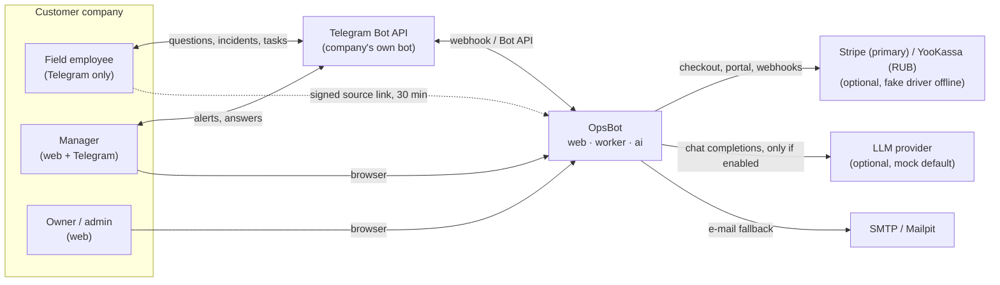
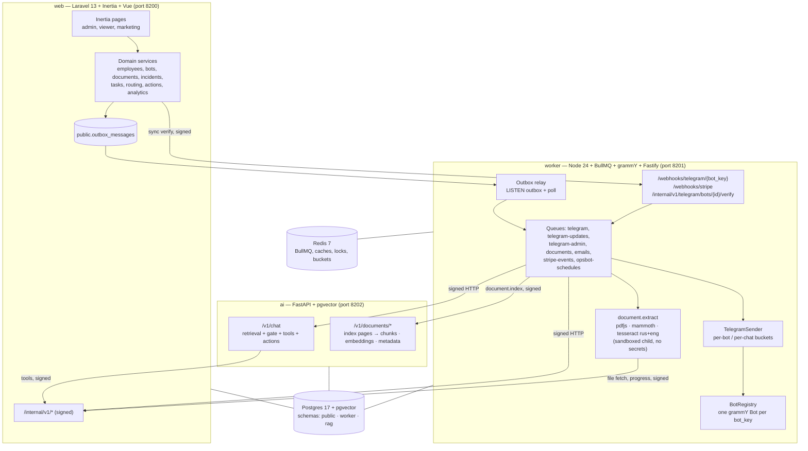
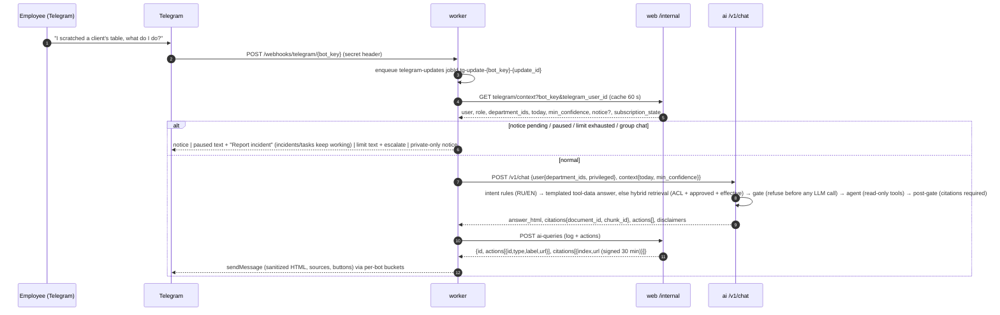
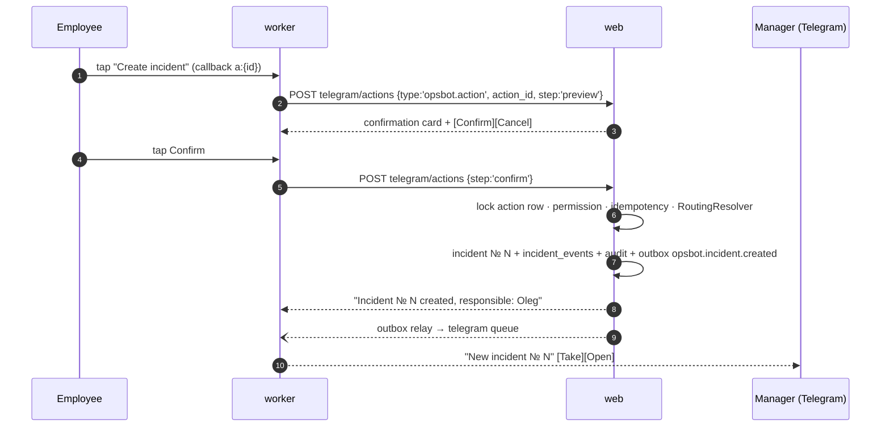
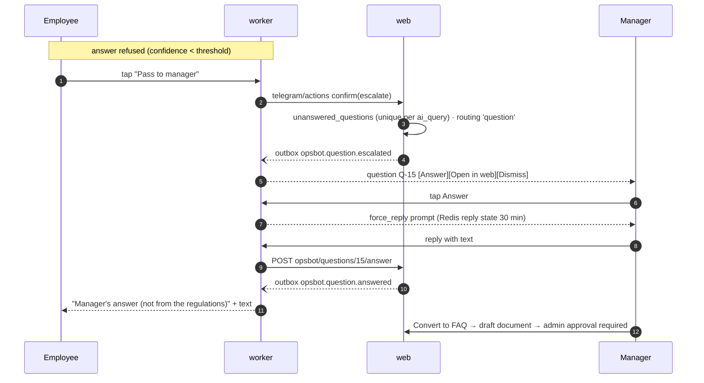
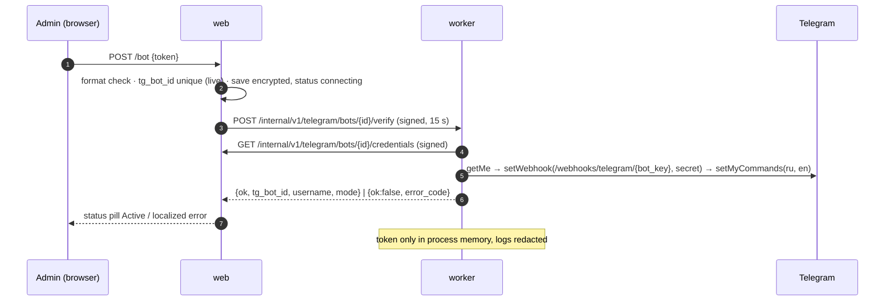
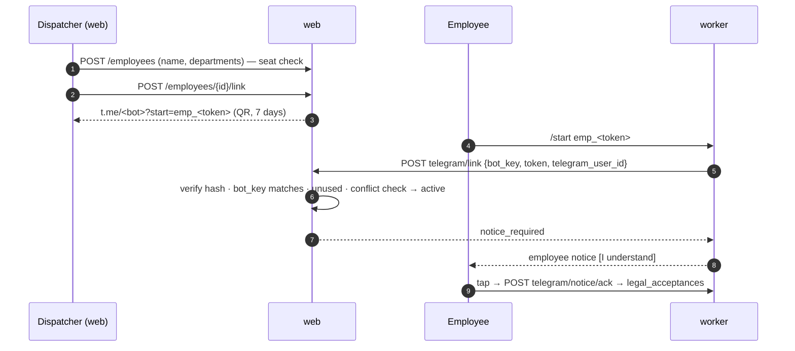
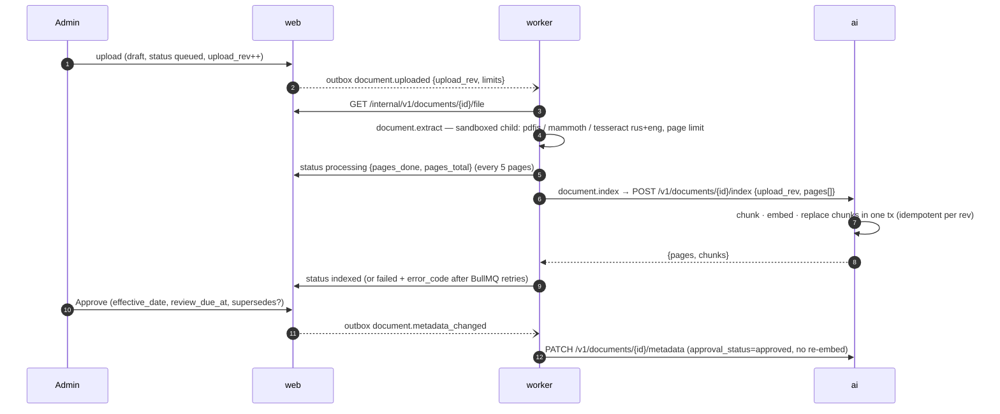
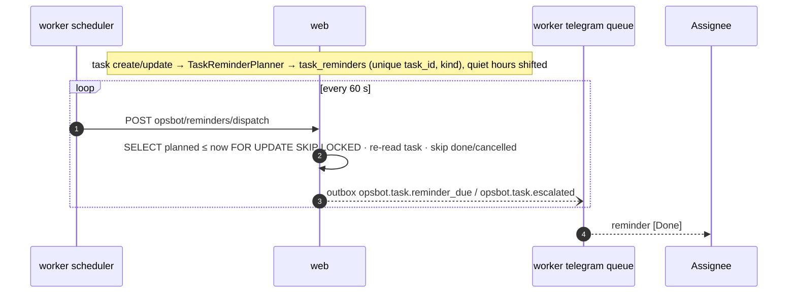

# OpsBot — Architecture

> Companion to `DOMAIN_CONTRACT.md` (names, payloads) and `adr/*` (decisions). Service boundaries and
> shared mechanics (signing, outbox, provider manager) come from `PLATFORM.md`.

## 1. Context

## 2. Containers and data ownership

| Schema / store | Owner | Contents |
|---|---|---|
| `public` | web | users, workspaces, roles, departments, employees & links, telegram_bots (encrypted token), telegram_accounts, documents (approval), incidents, tasks, reminders, routing, unanswered questions, ai_queries, actions, billing, audit, outbox |
| `worker` | worker | webhook_events, telegram_chats `(bot_key, telegram_user_id)`, telegram_group_notices |
| `rag` | ai | documents mirror (ACL + approval columns, `upload_rev`), chunks + embeddings + tsvectors, settings, ai_usage, conversation_turns |
| Redis | worker | BullMQ, extracted text (24 h), account cache, stored actions, flows, reply state, poll locks, rate buckets, registry pub/sub |

## 3. Key flows

### 3.1 Employee asks a question (Telegram)

### 3.2 Proposed action → incident (human confirms)

### 3.3 Escalation round trip

### 3.4 Connecting the company bot

### 3.5 Employee onboarding

### 3.6 Document ingest and approval

### 3.7 Task reminders

## 4. Cross-cutting

- **Security:** HMAC-signed internal calls (PLATFORM §4.1); bot tokens encrypted and confined to the
  credentials endpoint (ADR-0003); signed share links (ADR-0010); CSP `default-src 'self'`; private chats only.
- **Idempotency:** outbox job id = outbox id; Telegram update job id includes `bot_key`; action execution
  locked per `ai_query_actions` row; reminders unique per `(task_id, kind)`; extraction/indexing jobs keyed by `(document_id, upload_rev)`, stale revisions rejected.
- **Observability:** request id end to end; worker metrics per queue and per bot class; ai metrics for
  retrieval latency, refusals, dropped actions; audit log for every security-relevant action.
- **Offline-first:** fake Telegram transport (`TEST` tokens), fake billing, `mock` LLM, `hash`/`local`
  embeddings — the full E2E runs without network.

## 5. Deployment

`docker-compose.yml` (dev infra: pgvector 17, Redis 7, Mailpit on 5442/6392/1032+8231) and
`docker-compose.prod.yml` (web + worker + ai + scheduler). Production uses `TELEGRAM_MODE=webhook` with
`WORKER_PUBLIC_URL` on HTTPS; the worker can run several replicas (webhooks are stateless; polling is
dev-only under leader locks); document extraction/OCR runs in the worker (`documents` queue, extract
concurrency 2 per replica; the worker image installs `tesseract-ocr` with `rus` + `eng`; locally
`TESSDATA_PREFIX` points to a user-writable directory with `rus.traineddata`, ADR-0008 §8); the ai image
has no OCR dependencies. Dev compose adds `stripe/stripe-mock` on 12121 (PLATFORM §11.2). Stack per
PLATFORM §0.10 and the foundation baseline: ADR-0019.

## 6. ADR index

| ADR | Title |
|---|---|
| [0001](adr/0001-vertical-first-cleaning.md) | Vertical-first: cleaning & field service, starter pack |
| [0002](adr/0002-multi-bot-registry.md) | One Telegram bot per company: the multi-bot registry |
| [0003](adr/0003-bot-token-custody-and-connect-flow.md) | Bot token custody, connect / rotate / disconnect |
| [0004](adr/0004-telegram-only-employees.md) | Employees who exist only in Telegram; seats |
| [0005](adr/0005-document-approval-lifecycle.md) | Only approved, effective documents are answerable |
| [0006](adr/0006-confidence-gate.md) | Deterministic confidence gate and the golden set |
| [0007](adr/0007-ai-proposes-humans-execute.md) | The AI proposes actions; a human tap executes them |
| [0008](adr/0008-async-ingest-and-ocr.md) | Document processing + OCR in the worker (BullMQ); indexing in FastAPI |
| [0009](adr/0009-department-role-acl.md) | Department & role ACL by ids, cache invalidation |
| [0010](adr/0010-signed-citation-links.md) | Signed, short-lived source links bound to the employee |
| [0011](adr/0011-private-chats-only.md) | The bot answers only in private chats |
| [0012](adr/0012-plans-limits-and-grace.md) | Plans by seats and documents; over-limit; past due |
| [0013](adr/0013-reminders-and-quiet-hours.md) | Task reminders and quiet hours |
| [0014](adr/0014-escalation-round-trip.md) | Escalation round trip; manager answers are not policy |
| [0015](adr/0015-employee-privacy-and-query-visibility.md) | Question logging visibility and the employee notice |
| [0016](adr/0016-deterministic-analytics.md) | Deterministic analytics |
| [0017](adr/0017-no-streaming-in-mvp.md) | No token streaming in the MVP |
| [0018](adr/0018-notifications-rate-limits-and-polling.md) | Notification topics, e-mail fallback, per-bot limits, polling lock |
| [0019](adr/0019-foundation-baseline-and-strict-stack.md) | Foundation pinned to payflow-guard `002cb4e`; strict stack; single signing key |
